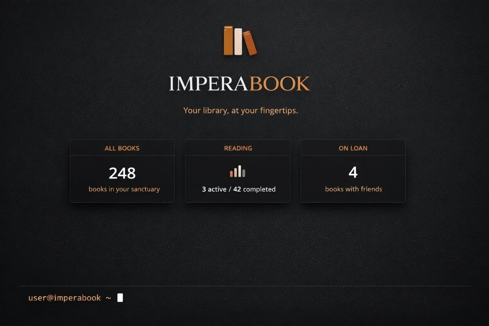

# ImperaBook

## Command-Based Home Library Management System

ImperaBook is a minimalist, high-performance home library management and cataloging ecosystem. Designed for power users, researchers, and collectors, it combines the speed of a keyboard-driven, command-based control interface with a highly polished typography-driven visual hierarchy.

## What Makes ImperaBook Unique?

Unlike traditional click-heavy library apps, ImperaBook treats your catalog like an efficient command center:

- **Command-Based Fluid Control**: A powerful, built-in command palette (accessible via shortcuts like `:` or `Ctrl+K`) allows you to query, catalog, lend, and batch-edit your library entirely from the keyboard—inspired by modern terminal tools like Vim and Helix.
- **Typography-Driven Aesthetic**: A dark, modern, minimalist user interface designed to maximize text legibility, screen real estate, and scannability.
- **Type-Driven Domain Modeling**: A pure, immutable C# core using closed sealed-record hierarchies, smart-constructor value objects, and phantom-typed identifiers to make invalid library states literally unrepresentable.

---

## Tech Stack & Architecture

ImperaBook is built as a monorepo demonstrating modern **Clean Architecture**, **CQRS (Command Query Responsibility Segregation)**, and **type-driven domain modeling** in C#.

### Frontend

- **Angular**: Structured single-page application utilizing reactive **Signals** for fine-grained state management and fast rendering.

### Backend (.NET 10, C#)

- **ImperaBook.Domain**: Pure, immutable domain core capturing the business rules and library invariants. Algebraic data types are modeled as closed sealed-record hierarchies, constrained values are wrapped in smart-constructor value objects returning explicit `Result` types, and identities are phantom-typed (`Id<TEntity>`)—keeping invalid states unrepresentable and the core free of side effects.
- **ImperaBook.Application**: Orchestrates the use cases, explicitly separating write operations (**Commands**) from read operations (**Queries**), with flat read models projected for the query side.
- **ImperaBook.Infrastructure.Data**: Isolates persistence behind repository interfaces and leverages **Entity Framework Core (EF Core)** for robust migrations and LINQ queries, keeping EF Core's mutable, change-tracking model out of the domain.
- **ImperaBook.API**: High-performance ASP.NET Core **Minimal APIs** exposed as clean, composable HTTP pipelines.

### Database & Cloud Infrastructure

- **PostgreSQL**: Relational database maximizing data integrity, deep JSONB querying for dynamic book metadata, and advanced full-text search.
- **AWS (Cloud-Native Deployment)**: Automated infrastructure managed via AWS CDK, utilizing Amazon RDS for PostgreSQL and low-latency API hosting.

---

## MVP Plan

### MVP1: Keyboard-Driven Core Management & Dashboard

- **Command Palette Execution**: Core CRUD operations driven by an inline command engine (e.g., `:add "The Hobbit" --author "Tolkien"`).
- **Relational Dashboard**: Real-time analytical widgets showing reading status breakdowns, category distributions, and total collection metrics.
- **Advanced Query Engine**: Multi-token full-text search combined with strict dynamic filtering (Language, publication year, custom metadata tags).

### MVP2: Automation, AI & Metadata Enrichment (Pro Tiers)

- **ISBN Smart Scan**: Camera-based mobile barcode scanning coupled with instant metadata population from external APIs (Google Books, Open Library).
- **AI-Powered Cover/Page Inference**: Image ingestion through OpenAI API to extract title, publishing data, or cataloging records from a photo of a book cover.
- **Advanced Export Utilities**: High-fidelity, print-ready document rendering alongside strict e-book configuration outputs (EPUB, PDF layouts).

---

## Monetization Model (Open-Core & Managed SaaS)

ImperaBook operates on a **Commercial Open Source (COSS)** / Open-Core methodology:

- **Self-Hosted Core**: The entire architecture is completely open and free to self-host for personal use under the AGPLv3 terms.
- **Managed SaaS (Subscription)**: A subscription tier providing instant infrastructure deployment, automatic cloud backups (AWS S3), cross-device cloud synchronization, real-time collaboration, and metered AI assistant allocations.

---

## License

This project is licensed under the **GNU Affero General Public License v3.0 (AGPLv3)**.

*Note: For closed-source commercial deployments, alternative hosting models, or enterprise white-labeling that bypasses the AGPL network-disclosure requirements, a separate **Commercial License** must be obtained from the author.*

---

**ImperaBook** — Your library, at your fingertips.
