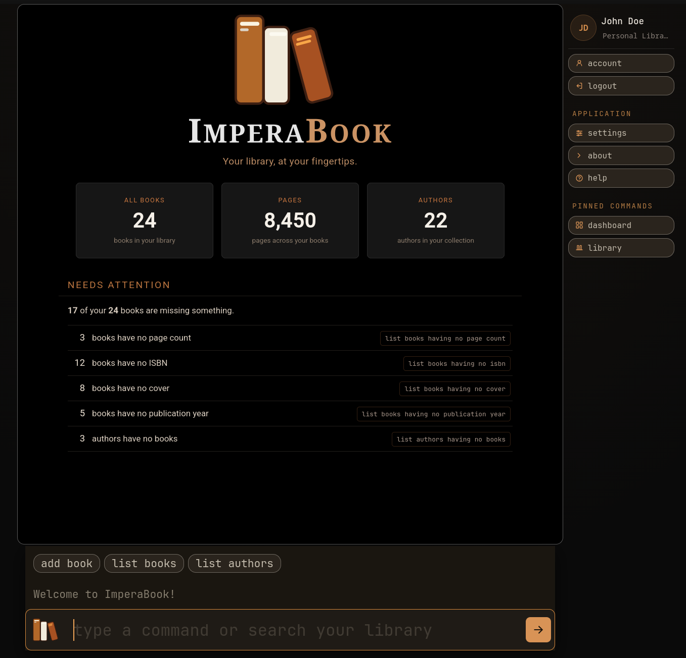
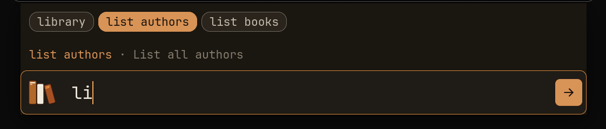

# ImperaBook

## Command-Based Home Library Management System

ImperaBook is a minimalist home library catalog built around a single idea: that managing a
collection should feel like operating a command center, not clicking through menus. It pairs a
keyboard-driven, command-based control surface with a dark, typography-driven interface — designed
for power users, researchers, and collectors who would rather type than hunt for buttons.



The product is fully multimodal — mouse and touch work everywhere — but it is *keyboard-first* on the
desktop, where the fastest path from intent to result is a typed command rather than a pointer
journey across the screen.

> **Status: MVP1 in development.** The application builds, deploys, and runs — the container image,
> the Compose stack, and the release pipeline are in place — but it is not yet distributed. Sign-in
> and per-user catalogs are in; self-service registration is not, so accounts are created by the
> operator. The command set is still filling in. Internal testing comes first; a public release
> follows only if that goes well.

---

## What Makes ImperaBook Different?

- **Command-driven control.** A single command bar drives the whole app. As you type, it
  autocompletes from a closed command grammar using token-match: typing `book` surfaces every book
  command (`add book`, `list books`, `show book`, …), typing `add` surfaces every `add` command.
  Anything that isn't a recognized command falls through to full-text search — there is no mode to
  toggle. Inspired by modern terminal tools like Vim and Helix.
- **The whole command is one visible sentence.** Parameters are written inline, each named by a
  connective — `add book with title "1984" by author "George Orwell"` — so nothing is hidden behind
  a prompt you have already answered. Order is free, the bar grows to fit as you type, and a finished
  command is ordinary text: editable, recallable, copyable, re-runnable with one value changed.
- **Typography-driven aesthetic.** A dark, minimalist interface built to maximize legibility,
  screen real estate, and scannability — the text *is* the interface.
- **Type-driven domain modeling.** A pure, immutable C# core using closed sealed-record hierarchies,
  smart-constructor value objects, and phantom-typed identifiers (`Id<TEntity>`) to make invalid
  library states literally unrepresentable. (The reasoning behind these choices, including their
  trade-offs and limits, lives in `DECISIONS.md`.)


---

## How It Works — Commands in Practice

A command is a sentence you write in one place. The verb comes first, then any number of parameters,
each introduced by a connective that names it and a value in quotes. There are no flags to memorize
and no dialog to tab through, and your hands never leave the keyboard.

**Add a book.** Type `add b` — autocomplete offers `add book`; `Tab` moves the highlight if several
commands match, `Enter` accepts the highlighted one.
Completion then keeps going: the suggestion row offers the command's next parameter — `with title`
first, since it is required — and accepting it appends `with title ""` with the caret between the
quotes. Type the value, and the row offers the next one. Optional parameters (`subtitled`,
`in language`, `published in`, `with isbn`) appear the same way, so you discover them rather than
memorize them, and any of them can be given in any order:

```
add book
  with title "Nineteen Eighty-Four"
  by author "George Orwell"
  published in "1949"
```

The bar lays the segments out one per line and grows to fit, and the workspace renders a *draft* of
the book that fills in beside it as each value lands. `Enter` saves; `Esc` clears the bar and nothing
is ever persisted. Because the command stays on screen as text, a typo four fields back is a cursor
move — and the next book by the same author is the same line with one value replaced.

**Sign in.** The first screen is the smallest the shell ever gets: one command available, so it
starts itself. You see `login` appear in the bar, then dedicated fields for username and password —
a password is never typed into the command bar, because that buffer is visible, editable, logged,
and parsed by a grammar with no escape rules. Signing in lands you on the dashboard; the command set
widens the moment the session exists. `logout` is an ordinary command and takes you back.

**Browse and read.** `list books` renders the collection. Because the command bar always holds
focus, bare letters are typing rather than shortcuts — so movement is separated by modifier instead:
plain `↑` `↓` scroll the viewport, `Alt` + arrows move the selection across the grid, and
`Ctrl + →` / `Ctrl + ←` (`next page` / `prev page`) fetch the adjacent batch of results. `Enter`
opens the selected row into detail, `Esc` steps back, `Home` / `End` (`top` / `bottom`) jump to the
first or last item on the page. These are navigation affordances — they read views, they never
mutate data.

**Search.** Just start typing words that aren't a command — `tolkien hobbit` — and the input falls
through to multi-token full-text search. No button, no separate search box.

**Filter, inspect, summarize.** `filter` walks you through structured filtering (language,
publication year). `show book` opens one book's full detail. `dashboard` renders the collection's
language breakdown and totals. `help` lists everything; `help add book` explains one command.

**Where this is going (MVP2).** *Composition*: grouping, boolean conditions, and chaining one
command's result into another — filtering a set and acting on the whole of it at once. That is where
the efficiency gain stops being a percentage and becomes an order of magnitude, and it is also the
point at which the flat grammar needs a real parser rather than the tokenizer that serves it today.


---

## Why Keyboard-First — Efficiency and Focus

The keyboard-first model is a deliberate efficiency bet, not just an aesthetic one. A
Keystroke-Level Model (KLM) analysis of common operations — using the standard, empirically derived
operator times from HCI — estimates roughly **50–65% less time** on everyday CRUD and filtering
tasks versus a typical mouse-driven library GUI, for an experienced user. The full breakdown is in
`efficiency-analysis.md`.

An honest note on those numbers: they are **model-derived estimates, not yet measured results**. The
KLM gives a principled order-of-magnitude projection, and the intent is to back it with real usage
data over time. Treat the percentages as "this is a large, structural gain" rather than as proven
benchmarks — and as a claim that holds *in some cases* (the experienced user, repeated cataloging
sessions), not a universal one. There is a learning curve, and on a phone the calculus inverts (see
*Mobile Companion*).

The part that matters more than the seconds is **cognitive**, and it is the harder thing for a GUI
to match:

- **No hand-switching.** The constant commute between mouse and keyboard — the costliest small motion
  in a typical interface — disappears. Hands stay home, which is less fatiguing across a long
  cataloging session and keeps you in flow.
- **Lower mental load.** A graphical UI asks the brain to visually re-scan the screen at every step:
  locate the button, absorb layout shifts, dismiss the modal. A command the user already knows runs
  on muscle memory, so the explicit "where do I click next" preparation largely vanishes.
- **Composition.** "Remove all English books published before 2010" is dozens of clicks in a GUI and
  a single expressed operation here. This is the order-of-magnitude lever, and it scales with the
  size of the collection.

The throughline is the project's actual goal: reduce the friction between what you want to do and
getting it done. Less pointer-hunting and less visual re-scanning means more attention left for the
work itself — a calmer, more focused way of interacting with software, not merely a faster one.

---

## Mobile Companion

The desktop app is the home for deep work — cataloging, querying, batch editing. But a phone is the
best tool for one specific job: standing in front of a physical shelf and entering books by scanning
them. ImperaBook's mobile app is therefore a **companion, not a port**.

A keyboard-first command line does not survive a soft keyboard — typing command syntax on a
touchscreen is a poor experience — so "keyboard-first" is a *desktop* statement, and the mobile
surface is touch-first by design. It is scoped to the two things a phone does best on the go:
**barcode / ISBN scanning** for fast ingestion, and **quick lookups** (checking whether you already
own a book while standing in a bookshop). The companion connects to your own instance or to an
optional managed cloud — it extends the desktop experience rather than replacing it.

---

## Tech Stack & Architecture

ImperaBook is a monorepo demonstrating modern **Clean Architecture**, **CQRS**, and **type-driven
domain modeling** in C#.

### Frontend

- **Angular** with reactive **Signals** for fine-grained state management and fast rendering; a
  recursive view layer driven by a closed `ViewNode` discriminated union, where the backend declares
  logical shape and the frontend owns all rendering.

### Backend (.NET 10, C#)

- **ImperaBook.Domain** — Pure, immutable domain core. Algebraic data types as closed sealed-record
  hierarchies, constrained values as smart-constructor value objects returning explicit `Result`
  types, phantom-typed identities — invalid states unrepresentable, the core free of side effects.
- **ImperaBook.Application** — Use-case orchestration, with write operations (**Commands**) cleanly
  separated from read operations (**Queries**) and flat read models projected for the query side.
- **ImperaBook.Contracts** — The closed `ViewNode` / `CommandResult` wire-contract types shared
  between Application and API: a fixed semantic union the backend composes and the frontend renders,
  declaring *what* a view is, never *how* it looks — not a Server-Driven UI layer.
- **ImperaBook.Infrastructure.Data** — Persistence behind repository interfaces via **EF Core**,
  keeping its mutable, change-tracking model out of the domain.
- **ImperaBook.Api** — ASP.NET Core **Minimal APIs**, with all errors mapped to a single RFC 9457
  ProblemDetails shape at the boundary. **ASP.NET Core Identity** with cookie sessions lives here
  rather than in Infrastructure: issuing and validating a session cookie is an HTTP concern, and the
  persistence library should not depend on the web stack to store a row. Authorization is
  default-deny, and per-command rather than per-route — there is only one route.

### Two channels, not a REST surface

The HTTP surface is split by purpose rather than by resource. A **control channel** —
`POST /api/command` — handles every command in the closed grammar: one request shape, one dispatch
path, one response contract. A **content channel** moves opaque bytes (cover images today, exports
and bulk import later) and never introduces meaning the command response didn't already state. The
command registry itself — every command and the connectives it accepts — is served by the backend at
`GET /api/commands`, so completion is driven by the backend's own vocabulary. What the frontend sends
is the raw text the user typed; the backend tokenizes and validates it, and that pass is the only one
that decides anything.

Both channels are closed to an unauthenticated caller, which creates a problem worth naming: the
registry that would tell a browser `login` exists is itself behind the session. The answer is a
third, deliberately tiny surface — a bootstrap route that hands out the `login` descriptor and the
login view, both republished from the same definitions the control channel uses, plus the sign-in
route itself. Credentials never travel as command text: it is logged, visible in the bar, and parsed
by a grammar with no escape rules, so `login` posts to its own endpoint. `logout` carries no secret
and stays an ordinary command.

### Database

- **PostgreSQL** — relational integrity and full-text search, with content-addressed image bytes
  stored in-database (`bytea`, `storage external`) so a single `pg_dump` is a complete backup.

### Build and release

The application ships as a single container image. A multi-stage build compiles the Angular bundle
and publishes the .NET API, then copies both into an ASP.NET runtime layer, with the frontend served
from the API's own `wwwroot`. There is no separate web server in the stack — one application
container and one PostgreSQL container, and nothing else to wire together.

CI runs the unit suites on every push and pull request. The integration suite needs Testcontainers
and a real PostgreSQL, so it runs nightly rather than on the fast loop. Releases are triggered by
hand: the same test workflows run first, then the image is built and pushed to GHCR under semantic
version tags, and the Compose file is attached to the GitHub release as the distribution entry
point.

The database schema is applied by EF Core migrations on startup — a deliberate choice for a
single-container, self-hosted deployment. Its named cost is that a failed migration stops the
application from starting; the alternative, letting it run against a half-built schema, is worse.

---

## MVP Plan

### MVP1 — Keyboard-Driven Core Management & Dashboard

- **Command execution.** Core CRUD via inline, connective-tagged commands with an anticipatory draft
  preview; autocomplete guides you to the canonical command and then through its parameters, one
  step at a time.
- **Dashboard.** Analytical widgets: language breakdown and total collection metrics.
- **Query engine.** Multi-token full-text search plus structured filtering (language, publication
  year).
- **Accounts.** Cookie-based sign-in over ASP.NET Core Identity, and per-user catalogs — every read
  is scoped to its owner in the query itself rather than by a filter each caller has to remember to
  pass. An instance can safely be reached by more than the machine it runs on. Self-service
  registration is deferred; accounts are created by the operator.

### MVP2 — Inline Power Commands, Automation & Enrichment

- **Command composition.** Grouping, boolean conditions, and chaining one command's result into
  another — bulk operations over a filtered set.
- **ISBN smart scan.** Camera barcode scanning on mobile with metadata population from external
  sources (Open Library, Google Books).
- **AI cover/page inference.** Extract cataloging data from a photo of a cover (bring-your-own-key or
  metered at cost — enrichment is never a gated feature).
- **Lending.** `lend` / `return`, so the shelf knows which books are with friends. This is also
  where *where a copy currently is* enters the model at all: MVP1 records only that a book belongs
  to a library, because that is the whole of what cataloguing asserts.
- **Export.** Print-ready PDF and e-book layout output.

---

## Editions

| | **Self-Hosted** | **Cloud** |
| --- | --- | --- |
| Price | Free for personal use | Subscription |
| Commercial use | Paid licence required | Included in subscription |
| Distribution | Docker Compose | Managed, nothing to install |
| Runs on | Your machine, your database | Hosted instance |
| Data | Entirely yours | Automatic backups, cross-device sync |
| Updates | You pull a new image | Continuous |

The self-hosted edition is the full application, not a crippled demo: the same commands, the same
catalog, the same interface. What the subscription buys is operations — hosting, backups, sync, and
the metered AI enrichment allowance — not features held back behind a paywall. What the licence
governs is *who* may use it, not *what* it does.

Neither edition is available yet. The section below describes how the self-hosted edition will be
installed — written down now because the path is built and tested end to end, and because the shape
of the install is part of the product rather than an afterthought.

### Running it yourself

Requirements: [Docker](https://docs.docker.com/get-started/get-docker/) with Compose. Nothing else —
no .NET SDK, no Node, no PostgreSQL install.

**1. Download the Compose file** into an empty directory:

```
mkdir imperabook && cd imperabook
curl -LO <compose file URL>
```

**2. Start the stack:**

```
docker compose up -d
```

The first run pulls two images and creates the database schema, so it takes a minute. Subsequent
starts are immediate.

**3. Open [http://localhost:8080](http://localhost:8080).** The catalog starts empty. Type
`add book` to catalog your first one, or `help` to see everything the command bar knows.

That is the whole installation. To stop it, `docker compose down`; to move to a newer release,
`docker compose pull && docker compose up -d`.

> **One account, created for you.** The first start creates the account named in the Compose file
> and no other — self-service registration is not built yet, so there is no sign-up screen and no
> way to add a second user without editing the stack. Change `IMPERABOOK_ADMIN_PASSWORD` before the
> first start; it is a real credential, not an internal one like the database password below.
>
> The Compose file still binds the port to `127.0.0.1`. Sign-in makes exposing the instance
> *possible* rather than advisable: there is no rate limiting on the login endpoint yet, and the
> session cookie is only marked `Secure` when the app is served over HTTPS. Publish it beyond
> localhost only behind a reverse proxy that terminates TLS.

#### What you just started

Two containers: the application and a PostgreSQL database. They talk to each other over a private
network, and only the application's port is published — to localhost. The database is not reachable
from outside the stack, which is why the Compose file ships with a fixed database password: it is an
internal credential between two containers, not a secret about your library.

If you publish the database port yourself — to connect with `psql`, for example — that stops being
true. Change `POSTGRES_PASSWORD` **and** the password in the application's connection string in the
same edit, and do it before the first start. PostgreSQL bakes the password into its data directory
on initialisation, so changing it afterwards means removing the volume and starting over.

#### Backup

Everything lives in one Postgres volume — the catalog, the cover images (stored in the database
rather than on disk), and the session signing keys. So a database dump is a complete backup, with
nothing else to remember:

```
docker compose exec -T db pg_dump -U imperabook imperabook > imperabook-backup.sql
```

Restoring into a fresh stack:

```
docker compose exec -T db psql -U imperabook -d imperabook < imperabook-backup.sql
```

The trade-off is named plainly in `DECISIONS.md` (ADR 19): storing image bytes in the database makes
dumps larger than they would be with a separate volume, and buys a backup that cannot be half-taken.
A dump taken without its image volume restores into a catalog where every cover is silently gone;
that failure mode is the one worth designing against.

The same reasoning puts the session signing keys in the database — a backup that restores everyone
into a logged-out state is the split-storage failure again, in a different costume. It has a
consequence worth stating: **treat the dump as sensitive.** It contains password hashes, which are
useless on their own, and the signing keys, which are not encrypted at rest and would let a holder
forge a session for any account. Store it the way you would store the password itself.

#### Starting over

To wipe the catalog and start from an empty one:

```
docker compose down -v
docker compose up -d
```

The `-v` removes the volume, so this deletes everything you have added. There is no undo.

#### Ports

The application is bound to `127.0.0.1` on purpose. Sign-in exists now, so this is no longer the
only thing standing between your catalog and the network — but the login endpoint has no rate
limiting yet and the session cookie needs HTTPS to be marked `Secure`, so reaching the instance from
elsewhere should mean a reverse proxy with TLS in front of it, not a wider bind. If port 8080 is
already taken, change the middle number in `docker-compose.yml`:

```yaml
    ports:
      - "127.0.0.1:9090:8080"
```

Then `docker compose up -d` again, and use `http://localhost:9090`.

---

## Documentation

- `DECISIONS.md` — architecture decisions, with trade-offs and known limitations stated plainly.
- `COMMANDS.md` — the full command reference and suggestion model.
- `UX.md` — UX patterns and their rationale.
- `efficiency-analysis.md` — the keystroke-level efficiency analysis (estimates pending real data).

---

## License

**ImperaBook is proprietary, closed-source software.** The source code is not published; the
application is distributed as a container image.

- **Personal use is free.** You may run the self-hosted edition at no cost for your own private,
  non-commercial use — your household's own library, your own collection.
- **Any other use requires a licence.** Use by or on behalf of a company, institution, or other
  organisation — including purely internal use, and including non-profits — is commercial use and
  needs a paid licence, whether self-hosted or cloud.
- **Cloud use** is governed by the subscription Terms of Service.
- Redistribution, resale, white-labeling, and hosting the software as a service for third parties
  require a separate commercial agreement.

Full terms are in the ImperaBook End User License Agreement (`EULA.md`).

Third-party open source components bundled in the distributed image are listed with their licenses
in `NOTICE.md`.

---

**ImperaBook** — Your library, at your fingertips.
