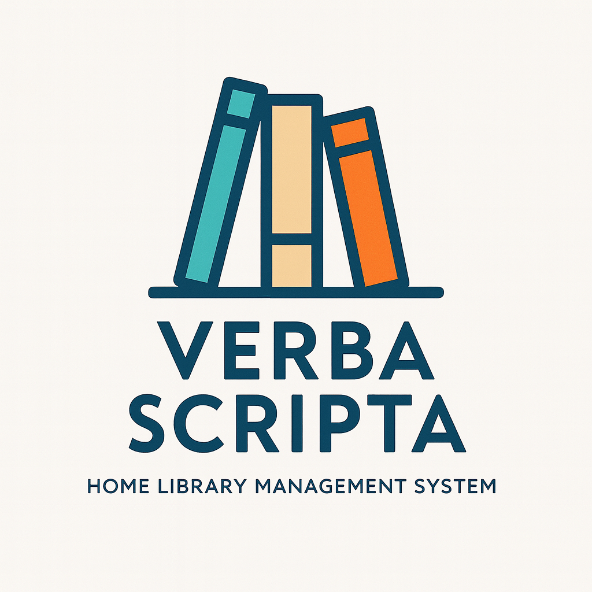

Verba Scripta is a structured home library management system designed to catalog, organize, and track personal book collections with precision.

## Tech Stack

The application provides a relational domain model for managing books, authors, publishers, categories, and lending records. Built on a robust backend stack using PostgreSQL and Entity Framework, it emphasizes data integrity, clean architecture, and maintainable schema evolution.

- ASP.NET Core Web API
- PostgreSQL
- EF Core
- Repository pattern
- Unit of Work
- JWT auth
- Swagger
- Integration tests

# Verba Scripta MVP Plan

Verba Scripta is a structured home library management system designed to catalog, organize, and track personal book collections with precision. This document outlines the Minimum Viable Product (MVP) features planned for the initial development phases.

---

## MVP1: Core Book Management (Web Interface)

### Features
- **CRUD Operations**: Create, Read, Update, Delete books in the personal library.
- **Statistics Dashboard**:
  - Total books
  - Books per category
  - Reading status breakdown
  - Author distribution
- **Search Functionality**:
  - Full-text search across titles, authors, descriptions, and notes
  - Filter by:
    - Author
    - Category
    - Language
    - Publication year
    - Custom tags

### Technical Stack (Suggested)
- Frontend: React or Vue.js
- Backend: Node.js with Express or Django
- Database: PostgreSQL or MongoDB

---

## MVP2: Smart Book Entry & Metadata Enrichment

### Features
- **Web Service Integration**:
  - Fetch book metadata (title, author, publisher, cover image, etc.) from external APIs (e.g., Google Books, Open Library)
- **ISBN Scanning via Mobile**:
  - Scan ISBN barcode using smartphone camera
  - Auto-fill book details via API lookup
- **Image-Based Book Entry**:
  - Take a picture of the book cover or page
  - Use OpenAI API to extract and infer book information

### Technical Stack (Suggested)
- Mobile: PWA or native app (React Native / Flutter)
- Image recognition: OpenAI API or Google Vision API
- ISBN lookup: Google Books API or ISBNdb

---

## Future Considerations
- User authentication and profiles
- Cloud sync and multi-device access
- Lending and borrowing tracking
- Reading progress and notes
- Export/import library data (CSV, JSON)

---

## License
MIT License 

## Contact
For questions or contributions, please open an issue or submit a pull request.

---

**Verba Scripta** — Organize your library, one book at a time.
